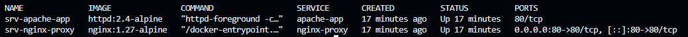
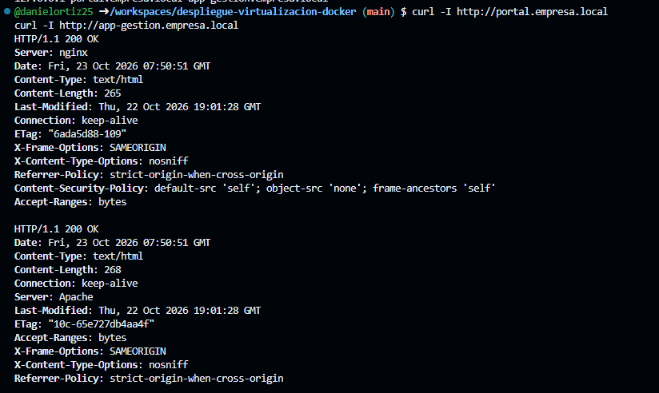
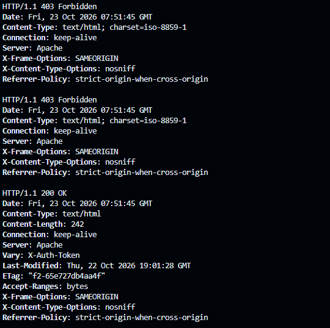
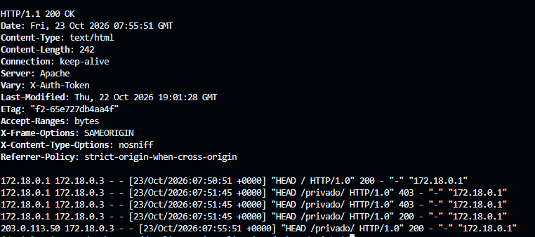

# despliegue-virtualizacion-docker

Despliegue seguro de una arquitectura desacoplada con contenedores Docker: **Nginx** como servidor de borde (proxy inverso) y **Apache HTTP Server** como backend aislado en una red interna.

Módulo 0614 Despliegue de Aplicaciones Web, 2º DAW.

## Objetivos

1. Desplegar la arquitectura Nginx (edge) + Apache (backend) con Docker Compose.
2. Restringir el endpoint `/privado/` de Apache a las peticiones que incluyan la cabecera `X-Auth-Token: DAW2026`.
3. Verificar que los logs de Apache registran la IP del cliente real.

## Resumen del problema que tuve y cómo lo resolví

No tenía Docker en mi equipo, así que probé el despliegue en un **GitHub Codespace**. Allí el portal (`portal.empresa.local`) funcionaba, pero la aplicación que pasa por el proxy (`app-gestion.empresa.local`) devolvía **`504 Gateway Time-out`**.

Descubrí que el fallo no estaba en mi configuración: **en el Codespace, los contenedores no podían comunicarse entre sí** (ni siquiera dos contenedores de prueba ajenos al proyecto). La causa era la política de reenvío (`FORWARD`) de `iptables-legacy`, que descartaba el tráfico de las redes `bridge` creadas por Docker Compose.

Lo resolví cambiando esa política y recreando el despliegue:

```bash
sudo iptables-legacy -P FORWARD ACCEPT
docker compose down
docker compose up -d
```

El diagnóstico completo, paso a paso, está en [INC-1](#inc-1-504-gateway-time-out-en-app-gestionempresalocal).

## Arquitectura

```
Cliente (navegador / curl)
   │  http://portal.empresa.local        (Host: portal.empresa.local)
   │  http://app-gestion.empresa.local   (Host: app-gestion.empresa.local)
   ▼  TCP :80
┌─────────────────────────────────────────────────┐
│ srv-nginx-proxy  (Nginx · único puerto público) │
│  ├─ portal.empresa.local       → ./nginx/html   │
│  └─ app-gestion.empresa.local  → proxy_pass ────┼──┐
└─────────────────────────────────────────────────┘  │
          red bridge interna "red-corp"              │
┌─────────────────────────────────────────────────┐  │
│ srv-apache-app  (Apache · sin "ports")          │◄─┘
│  ├─ /         → ./apache/htdocs                 │
│  └─ /privado  → exige X-Auth-Token: DAW2026     │
└─────────────────────────────────────────────────┘
```

Nginx es el único contenedor que publica un puerto en el host. Apache no tiene la directiva `ports`, por lo que solo es accesible desde la red `red-corp`, a través de Nginx.

## Estructura del proyecto

```
despliegue-virtualizacion-docker/
├── docker-compose.yml           # Definición de la infraestructura
├── .gitignore                   # Excluye logs (IP = dato personal) y archivos de sistema
├── README.md
├── img/                         # Capturas de evidencia
├── nginx/
│   ├── conf.d/default.conf      # Hosts virtuales, proxy inverso y hardening
│   ├── html/index.html          # portal.empresa.local
│   └── logs/                    # Logs de Nginx montados en el host (no versionados)
└── apache/
    ├── conf/vhost.conf          # Host virtual, /privado/ e IP real
    ├── htdocs/
    │   ├── index.html           # app-gestion.empresa.local
    │   └── privado/index.html   # Zona restringida
    └── logs/                    # Logs de Apache montados en el host (no versionados)
```

## Entorno de pruebas

El PDF de la actividad indica Windows 11 con Docker Desktop. Como no disponía de Docker en mi equipo, hice las pruebas en un **GitHub Codespace** (Ubuntu 24.04, Docker 29.8.0). Esto me provocó dos incidencias propias del entorno, documentadas en el apartado de incidencias.

## Requisitos

- Docker y Docker Compose
- Git

## Despliegue

Todos los comandos se ejecutan desde la raíz del proyecto, donde está `docker-compose.yml`.

**1. Resolución de nombres local.** Los dominios son de laboratorio, así que se añaden al archivo `hosts`:

- Linux / Codespaces: `echo "127.0.0.1 portal.empresa.local app-gestion.empresa.local" | sudo tee -a /etc/hosts`
- Windows (PowerShell como administrador): `Add-Content C:\Windows\System32\drivers\etc\hosts "127.0.0.1 portal.empresa.local app-gestion.empresa.local"`

**2. Carpetas de logs:**

```bash
mkdir -p nginx/logs apache/logs
```

**3. Validar y levantar:**

```bash
docker compose config
docker compose up -d
docker compose ps
```

**4. Parar y eliminar:**

```bash
docker compose down
```

## Configuración

### Docker Compose

| Decisión | Motivo |
|---|---|
| Nginx es el único servicio con `ports` | Mínima exposición perimetral. |
| Apache sin `ports` y en la red `red-corp` | Aislado: no se puede acceder desde el host sin pasar por el proxy. |
| Volúmenes `:ro` (`conf.d`, `html`, `htdocs`, `vhost.conf`) | Si un contenedor es vulnerado, no se puede modificar el código ni la configuración. |
| Volúmenes de logs con escritura | Son los únicos montajes que necesitan escribir. |
| `nginx:1.27-alpine` y `httpd:2.4-alpine` | Versiones fijas y base Alpine, con menor superficie de ataque. |
| `depends_on` | Nginx resuelve `apache-app` al arrancar, así que Apache debe existir antes. |
| `restart: unless-stopped` | Los servicios se recuperan tras un reinicio. |

### Nginx (`nginx/conf.d/default.conf`)

- **Host virtual `portal.empresa.local`**: sirve `nginx/html` directamente.
- **Host virtual `app-gestion.empresa.local`**: `proxy_pass http://apache-app:80`. El nombre del servicio se resuelve con el DNS interno de Docker.
- **Cabeceras de trazabilidad** enviadas a Apache: `Host`, `X-Real-IP`, `X-Forwarded-For` y `X-Forwarded-Proto`.
- **Hardening**: `server_tokens off`, `X-Frame-Options`, `X-Content-Type-Options`, `Referrer-Policy` y, en el portal, `Content-Security-Policy`. No añadí `X-XSS-Protection`: está obsoleto y OWASP recomienda no activarlo.
- **Timeouts** de proxy (30 s de conexión, 60 s de lectura y escritura) como mitigación frente a ataques lentos (Slowloris).
- **Logs separados** por host virtual, en `nginx/logs/`.
- **`proxy_pass_header Server`**: por defecto Nginx descarta la cabecera `Server` del backend y pone la suya, lo que impediría distinguir qué servidor responde. Con esta directiva se deja pasar la de Apache, que no muestra versión.

### Apache (`apache/conf/vhost.conf`)

Se carga con `httpd-foreground -c "Include conf/extra/vhost.conf"` (ver `docker-compose.yml`), sin sustituir el `httpd.conf` de la imagen.

- **Hardening**: `ServerTokens Prod` y `ServerSignature Off`, de modo que la cabecera `Server` solo dice `Apache`.
- **Endpoint restringido `/privado`**:

  ```apache
  <Location "/privado">
      Require expr "%{HTTP:X-Auth-Token} == 'DAW2026'"
  </Location>
  ```

  Si la petición no lleva la cabecera, o su valor es otro, Apache responde `403 Forbidden`.
- **IP real del cliente** con `mod_remoteip`:
  - `RemoteIPHeader X-Forwarded-For` lee la cabecera que envía Nginx.
  - `RemoteIPInternalProxy 172.16.0.0/12` indica que solo se confía en ella si la petición llega desde la red interna de Docker.
- **Formato de log `realip`**, guardado en `apache/logs/access.log`: `%a` (IP del cliente, ya corregida), `%{c}a` (IP de la conexión directa, el contenedor Nginx) y las cabeceras `X-Forwarded-For` y `X-Real-IP`.

## Verificación

### 1. Estado de los contenedores

```bash
docker compose ps
```

`srv-nginx-proxy` publica `0.0.0.0:80->80/tcp` y `srv-apache-app` solo expone `80/tcp`, sin mapeo al host. Se cumple el requisito de aislar Apache.



### 2. Respuesta de cada servidor

```bash
curl -I http://portal.empresa.local
curl -I http://app-gestion.empresa.local
```

- `portal.empresa.local`: `200 OK`, `Server: nginx` sin versión y las cabeceras de seguridad (`X-Frame-Options`, `X-Content-Type-Options`, `Referrer-Policy` y `Content-Security-Policy`).
- `app-gestion.empresa.local`: `200 OK`, `Server: Apache` sin versión. La respuesta viene del backend, a través del proxy.



### 3. Endpoint restringido `/privado/`

```bash
curl -sI http://app-gestion.empresa.local/privado/ | head -n 1
curl -sI -H "X-Auth-Token: otro" http://app-gestion.empresa.local/privado/ | head -n 1
curl -sI -H "X-Auth-Token: DAW2026" http://app-gestion.empresa.local/privado/ | head -n 1
```

| Petición | Respuesta |
|---|---|
| Sin cabecera | `403 Forbidden` |
| `X-Auth-Token: otro` | `403 Forbidden` |
| `X-Auth-Token: DAW2026` | `200 OK` |



### 4. IP del cliente real en los logs de Apache

Con Docker, las conexiones locales llegan a Nginx desde la puerta de enlace de la red (`172.18.0.1`) y no desde una IP pública. Para comprobar que Apache registra la IP original que viaja en `X-Forwarded-For`, simulé un cliente externo con una IP del rango de documentación `203.0.113.0/24`:

```bash
curl -I -H "X-Auth-Token: DAW2026" -H "X-Forwarded-For: 203.0.113.50" http://app-gestion.empresa.local/privado/
tail -n 5 apache/logs/access.log
```

Resultado en `apache/logs/access.log`:

```
172.18.0.1   172.18.0.3 - - [23/Oct/2026:07:50:51 +0000] "HEAD / HTTP/1.0" 200 - "-" "172.18.0.1"
203.0.113.50 172.18.0.3 - - [23/Oct/2026:07:55:51 +0000] "HEAD /privado/ HTTP/1.0" 200 - "-" "172.18.0.1"
```

Cómo leer cada línea, según el formato `realip`:

| Campo | Significado | Petición normal | Petición con `X-Forwarded-For` |
|---|---|---|---|
| 1.º (`%a`) | IP del cliente, corregida por `mod_remoteip` | `172.18.0.1` (la puerta de enlace) | **`203.0.113.50`** (la IP original) |
| 2.º (`%{c}a`) | IP de la conexión directa: el contenedor Nginx | `172.18.0.3` | `172.18.0.3` |
| `"-"` | Cabecera `X-Forwarded-For` | `-` | `-` |
| Último | `X-Real-IP`: la IP que vio Nginx | `172.18.0.1` | `172.18.0.1` |

La cabecera `X-Forwarded-For` aparece como `-` porque `mod_remoteip` la consume y la retira una vez procesada. Lo importante es el primer campo: sin `mod_remoteip`, Apache registraría `172.18.0.3` (Nginx) en todas las peticiones y no se podría identificar al cliente.



## Incidencias

### INC-1: `504 Gateway Time-out` en `app-gestion.empresa.local`

**Qué me pasó.** Al levantar el despliegue en el Codespace, el portal respondía bien, pero el dominio que pasa por el proxy devolvía un error:

```
$ curl -I http://app-gestion.empresa.local
HTTP/1.1 504 Gateway Time-out
Server: nginx
```

En el log de error de Nginx (`nginx/logs/app_gestion_error.log`) vi:

```
[error] upstream timed out (110: Operation timed out) while connecting to upstream,
client: 172.18.0.1, server: app-gestion.empresa.local, request: "HEAD / HTTP/1.1",
upstream: "http://172.18.0.2:80/", host: "app-gestion.empresa.local"
```

Es un timeout al *conectar* con el upstream, no un rechazo (`connection refused`): Nginx intentaba conectarse, pero los paquetes no llegaban a Apache.

**Cómo lo diagnostiqué.**

1. Con `docker compose ps` comprobé que los dos contenedores estaban en `Up`, así que no era un fallo de arranque.
2. Con `docker compose logs apache-app` vi que Apache arrancaba sin errores y cargaba mi host virtual (`Command line: 'httpd -D FOREGROUND -c Include conf/extra/vhost.conf'`).
3. Hice una petición a Apache desde dentro de su propio contenedor, y respondió `200 OK` con `Server: Apache`: Apache y su configuración funcionaban.
4. Con `docker inspect` confirmé que Apache era `172.18.0.2` y Nginx `172.18.0.3`, es decir, la IP que usaba Nginx en el log era la correcta.
5. Hice `ping` entre los dos contenedores, en ambos sentidos: 100 % de pérdida de paquetes, sin ninguna aplicación de por medio.
6. Recreé la red (`docker compose down`, `docker network prune`, `docker compose up -d`): el problema seguía.
7. Hice una **prueba de control**: creé dos contenedores `alpine` de prueba en una red nueva, sin relación con mi proyecto, y tampoco se comunicaban (`ping` con 100 % de pérdida).

**Causa.** El problema no estaba en `default.conf`, `vhost.conf` ni `docker-compose.yml`, sino en la red de Docker del entorno de pruebas. En el Codespace conviven reglas `iptables-nft` e `iptables-legacy`. En las tablas *legacy* la política de `FORWARD` era `DROP`, con reglas solo para el puente por defecto `docker0`. Por eso se descartaba el tráfico entre contenedores de redes `bridge` definidas por el usuario, como `red-corp`.

**Cómo lo resolví.** Cambié la política de reenvío de las tablas *legacy* y recreé el despliegue:

```bash
sudo iptables-legacy -P FORWARD ACCEPT
docker compose down
docker compose up -d
```

Después, una petición de Nginx a Apache devolvió `200 OK` con `Server: Apache` y el proxy empezó a funcionar. Es un ajuste del entorno de pruebas, no del proyecto: con Docker Desktop no hace falta. En el Codespace el cambio se pierde al reiniciarlo.

### INC-2: `Could not resolve host` tras reiniciar el Codespace

**Qué me pasó.** Al retomar las pruebas al día siguiente:

```
$ curl -I http://portal.empresa.local
curl: (6) Could not resolve host: portal.empresa.local
```

**Causa.** Al reiniciarse el Codespace se perdió la línea que había añadido a `/etc/hosts`, que es la que traduce los dominios de laboratorio a `127.0.0.1`.

**Cómo lo resolví.** Volví a añadir la línea, sin duplicarla:

```bash
grep empresa /etc/hosts || echo "127.0.0.1 portal.empresa.local app-gestion.empresa.local" | sudo tee -a /etc/hosts
```

## Cumplimiento: logs y RGPD

- Las direcciones IP son datos personales. El artículo 32 del RGPD exige confidencialidad, integridad y trazabilidad de los tratamientos.
- Los logs se guardan en el host (`nginx/logs/` y `apache/logs/`) para que no se pierdan al eliminar el contenedor, con un registro separado por host virtual.
- Se registra la IP real del cliente en Apache. Sin ella, ante un incidente, todos los registros apuntarían al proxy y no se podría identificar al origen.
- Los logs están en `.gitignore`: nunca deben subirse al repositorio, porque publicarían datos personales.

## Resolución de problemas

| Error | Causa probable | Solución |
|---|---|---|
| `bind: address already in use` / `port is already allocated` | El puerto 80 del host está ocupado (IIS, Skype, otro contenedor) | `netstat -ano \| findstr :80` para identificar el proceso; o cambiar el puerto del host en el compose (por ejemplo `8080:80`) |
| `502 Bad Gateway` | Nginx no alcanza a Apache | `docker compose ps`; comprobar que ambos están en `red-corp` y que `proxy_pass` usa el nombre del servicio (`apache-app`) |
| `504 Gateway Time-out` | Los paquetes no llegan de Nginx a Apache | Ver INC-1: probar conectividad entre contenedores y reglas de red de Docker |
| `ERR_NAME_NOT_RESOLVED` / `Could not resolve host` | El dominio no resuelve a `127.0.0.1` | Ver INC-2: revisar la línea del archivo `hosts` |
| `403 Forbidden` en `/privado/` | Falta la cabecera `X-Auth-Token` o su valor no es `DAW2026` | Es el comportamiento esperado; enviar la cabecera correcta |
| Apache no arranca | Error de sintaxis en `vhost.conf` | `docker compose logs apache-app` |

## Limitaciones y mejoras posibles

- Nginx usa `$proxy_add_x_forwarded_for`, que añade la IP del cliente al final de lo que el cliente ya haya enviado. En un servidor de borde expuesto a Internet, un cliente podría falsificar el inicio de esa cabecera. Para evitarlo, se sustituiría por `$remote_addr`. La prueba de la IP real se apoya precisamente en esto, al simular un cliente externo con una cabecera enviada a mano.
- El token `DAW2026` es un valor de laboratorio y aparece en la configuración. En un entorno real se gestionaría como secreto y no se versionaría.
- La comunicación es HTTP, sin TLS. En producción se añadiría HTTPS en Nginx y la cabecera HSTS.
